# Identity — KYC Onboarding

Flutter iOS/Android onboarding with a real TypeScript/NestJS 12.1.2 API (Express adapter) and PostgreSQL. Material 3, primary green `#026220`. Registration and email OTP, login, secure session restore, password reset, personal details, camera document/selfie upload, review/edit, submission with a read-only profile preview, rejection/resubmission and saved progress are implemented. There is no production mock API or unrelated dashboard.

**Hướng dẫn tiếng Việt:** [Cài đặt và khởi động từ đầu trên macOS](docs/local-setup.md) — cài công cụ, PostgreSQL/Mailpit, các terminal cần chạy, lấy OTP, dừng và khởi động lại. [Xoá toàn bộ dữ liệu local để chạy lại từ đầu](docs/local-setup.md#9-xoá-toàn-bộ-dữ-liệu-local-và-chạy-lại-từ-đầu) gồm database, media, email, tài khoản admin và dữ liệu app trên thiết bị.

Optional [OCR and face comparison](docs/identity-verification.md) run locally with Tesseract Vietnamese/English OCR and OpenCV YuNet/SFace, with no cloud account or API fee. An AWS Textract/Rekognition adapter is also available. Applicants run checks explicitly from Review; extracted text/fields and selfie-to-document similarity remain available to reviewers and in each immutable submission. The local engine needs a one-time model/runtime setup. Results assist manual review and do not include liveness; AWS Textract does not support Vietnamese text.

## Main-flow screenshots

Follow the main flow directly on GitHub below. Click any screenshot to view it at full size. These frames come from the [complete demo recording](demo/full-flow-voiced.mp4); all personal details and document/selfie illustrations are fictional. Images and their [source timestamps](demo/screenshots/manifest.json) are stored in `demo/screenshots/`.

The applicant (`applicant.demo@kyc.example`), reviewer candidate (`reviewer.demo@kyc.example`) and super admin (`admin.demo@kyc.example`) use separate accounts. The reviewer candidate starts as a **User** and receives **Reviewer** access after admin approval. Personal details, progress, uploaded images, permissions, decisions and submission history are persisted on the **server** and loaded by the app.

**Register and enter personal details**

| 1. Create account | 2. Verify email with OTP | 3. Save personal details |
| --- | --- | --- |
| <a href="demo/screenshots/01-register.png">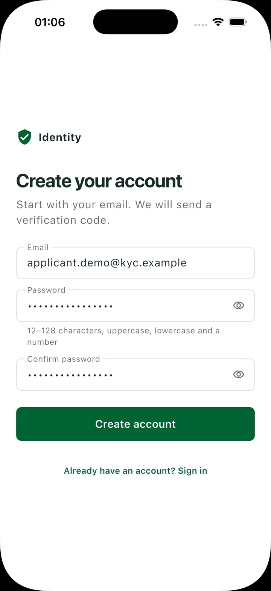</a> | <a href="demo/screenshots/02-verify-email.png">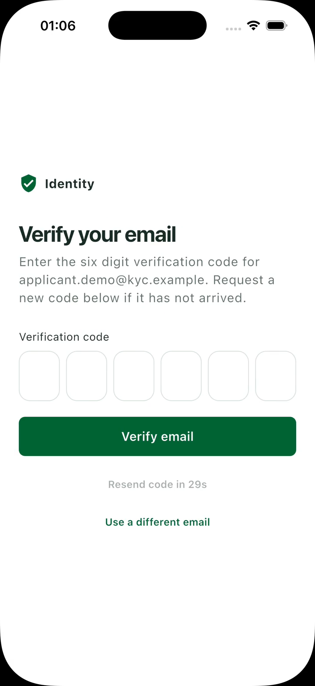</a> | <a href="demo/screenshots/03-personal-details.png">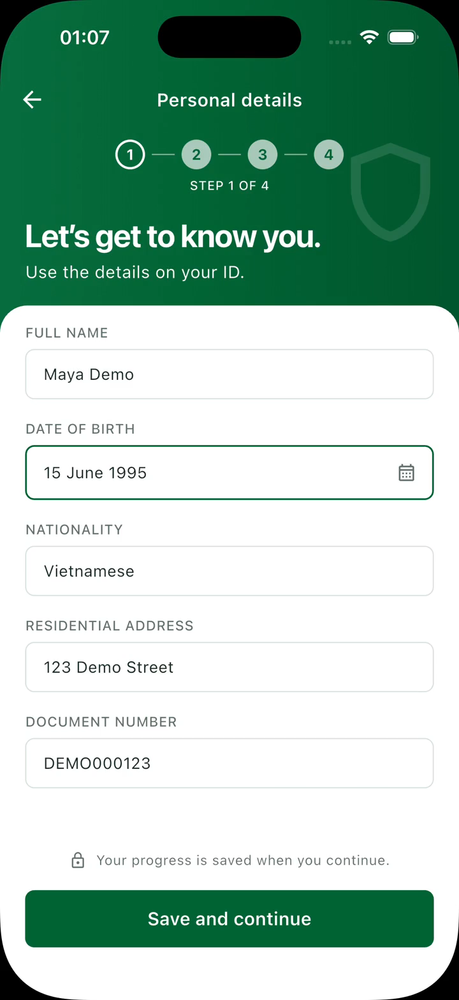</a> |

**Upload synthetic photos and review the profile**

| 4. Identity document | 5. Selfie | 6. Review before submitting |
| --- | --- | --- |
| <a href="demo/screenshots/04-document-upload.png">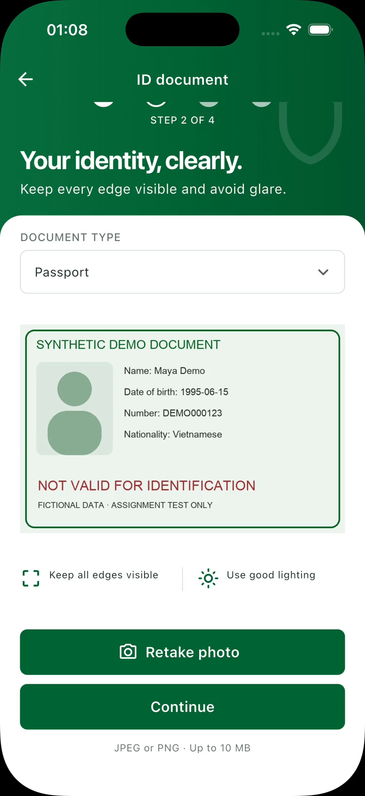</a> | <a href="demo/screenshots/05-selfie-upload.png">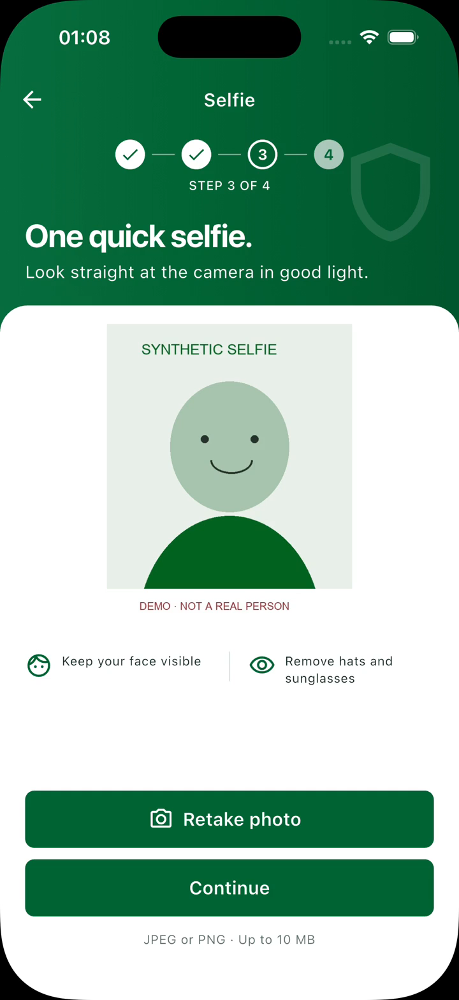</a> | <a href="demo/screenshots/06-review-profile.png">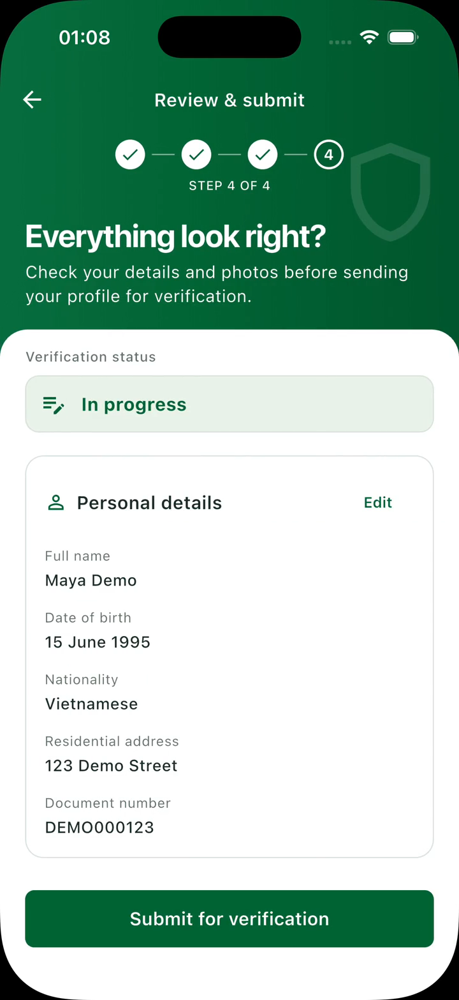</a> |

**Submit the profile and grant Reviewer access**

| 7. Pending review | 8. User requests Reviewer access | 9. Admin grants access |
| --- | --- | --- |
| <a href="demo/screenshots/07-pending-review.png">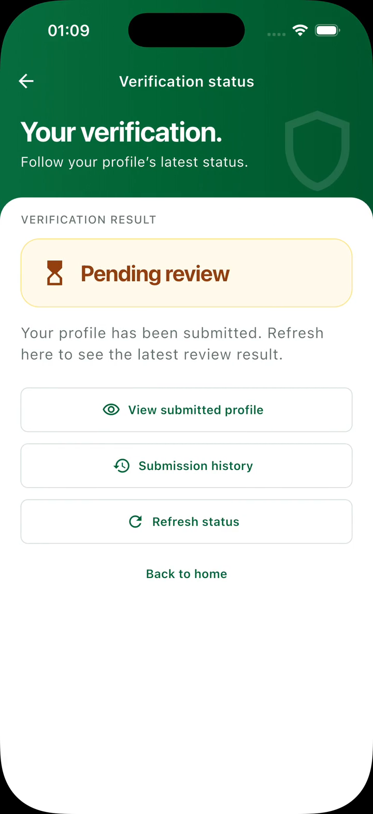</a> | <a href="demo/screenshots/08-request-reviewer-access.png">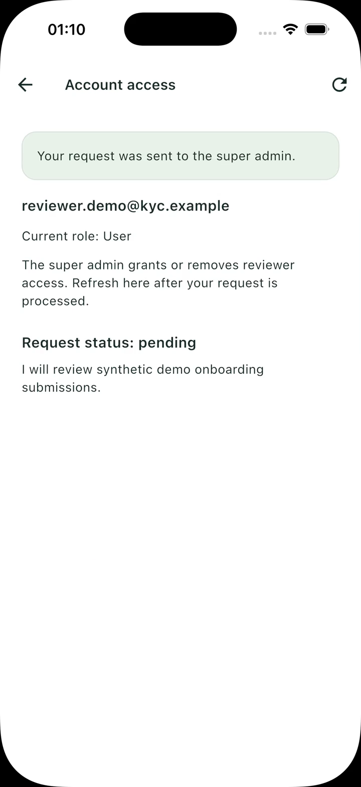</a> | <a href="demo/screenshots/09-admin-grants-reviewer.png">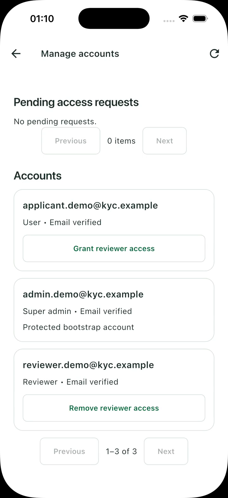</a> |

**Open the reviewer queue and request a correction**

| 10. Review profiles from Home | 11. Applicant in the queue | 12. Request a new selfie |
| --- | --- | --- |
| <a href="demo/screenshots/10-reviewer-home.png">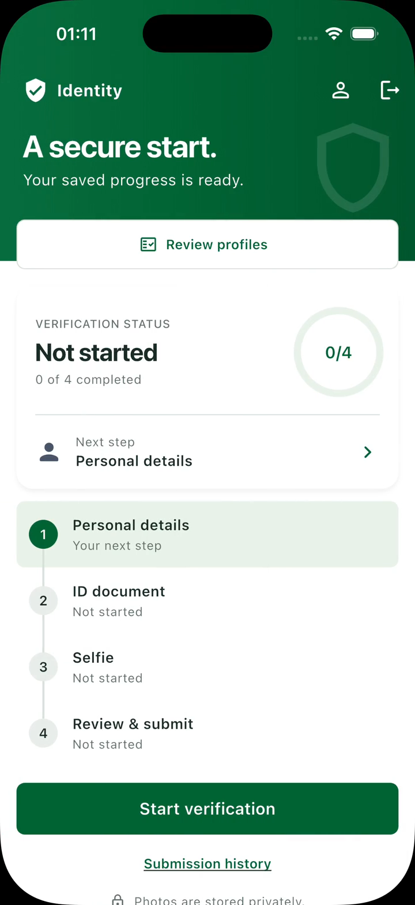</a> | <a href="demo/screenshots/11-reviewer-queue.png">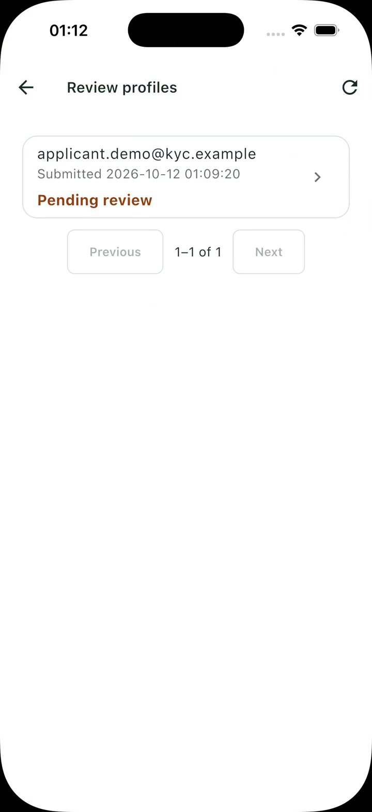</a> | <a href="demo/screenshots/12-request-selfie-update.png">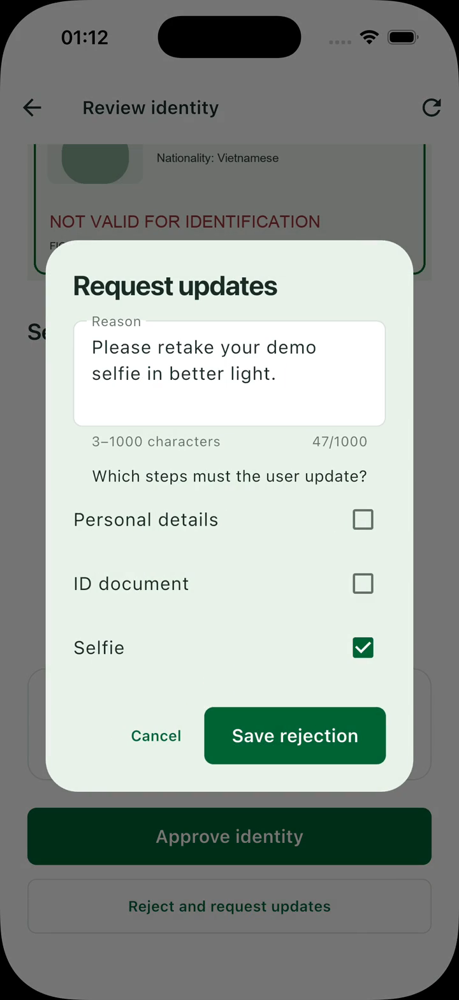</a> |

**Correct the requested step and resubmit**

| 13. Applicant sees the reason | 14. Replace only the selfie | 15. Resubmit for review |
| --- | --- | --- |
| <a href="demo/screenshots/13-applicant-changes-requested.png">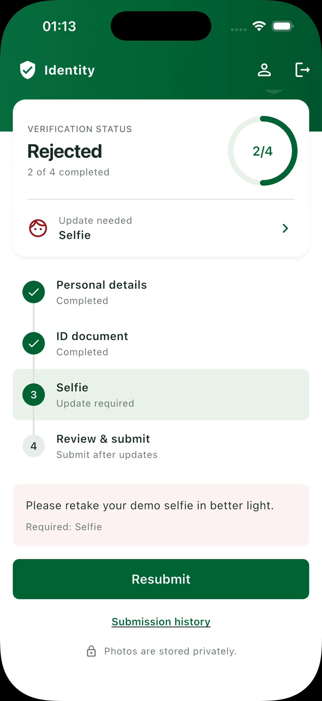</a> | <a href="demo/screenshots/14-replace-selfie.png">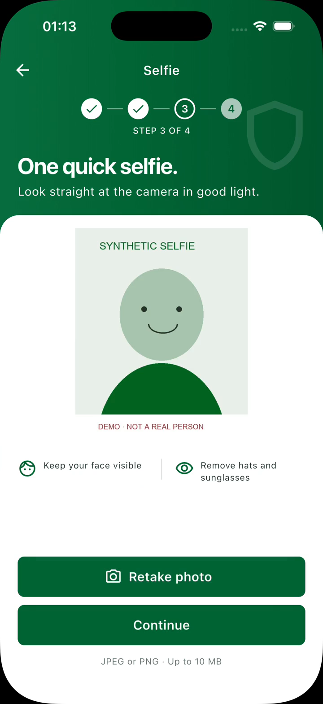</a> | <a href="demo/screenshots/15-resubmitted.png">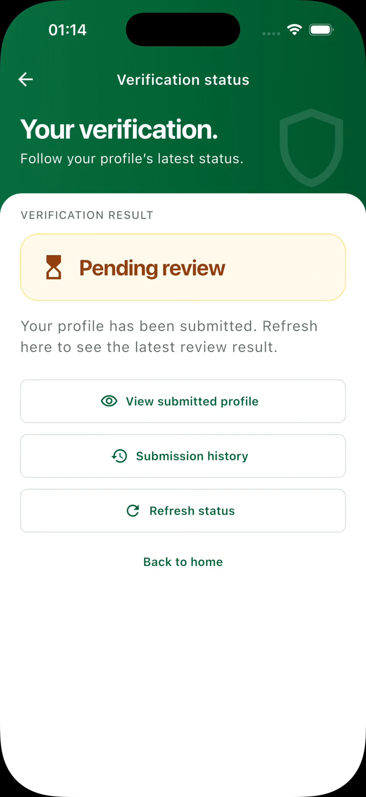</a> |

**Approve and view the result and history**

| 16. Reviewer confirms approval | 17. Applicant is Verified | 18. Both submissions in history |
| --- | --- | --- |
| <a href="demo/screenshots/16-reviewer-approval.png">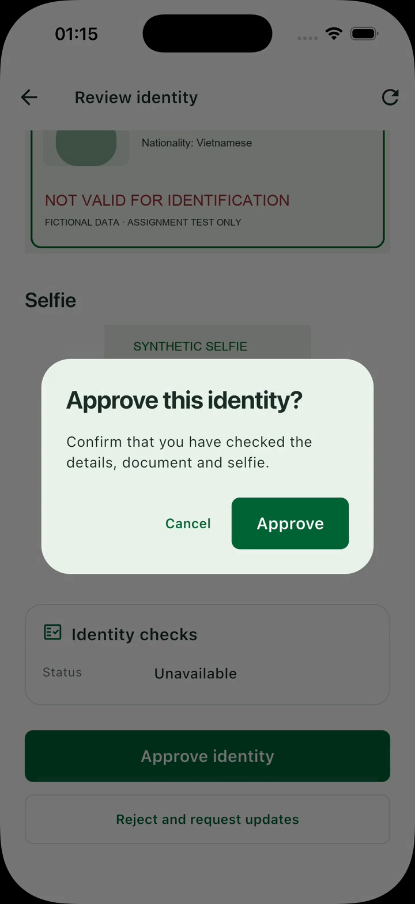</a> | <a href="demo/screenshots/17-verified.png">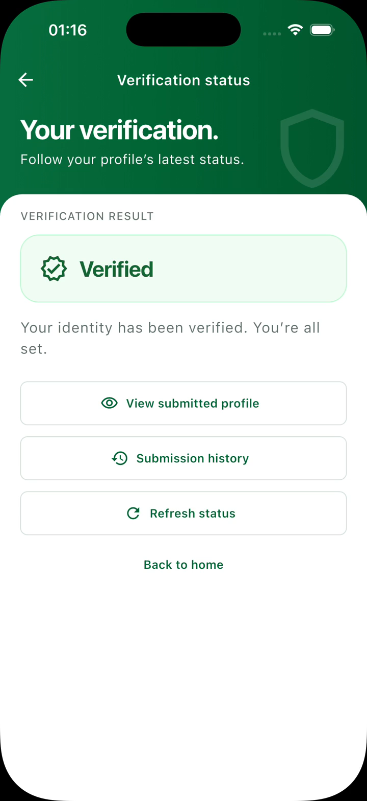</a> | <a href="demo/screenshots/18-submission-history.png">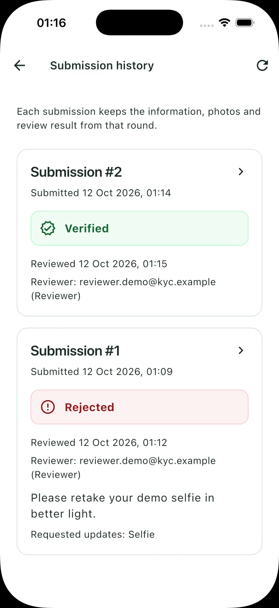</a> |

## Run locally

Prerequisites: Flutter **3.44.6** / its bundled Dart **3.12.2**, Node **22 LTS** (minimum **22.12**), npm, Docker Compose, Xcode for iOS or Android SDK/JDK17 for Android. Put the Flutter SDK's `bin` directory first in `PATH` if you also installed standalone Dart. Lockfiles are committed. Docker is optional if you use the embedded PostgreSQL alternative below.

For the Docker setup, open Docker Desktop and check that both commands succeed:

```sh
docker --version
docker compose version
```

If Docker is unavailable, use [Without Docker](#without-docker) or the [Vietnamese guide](docs/local-setup.md#4-cách-a--chạy-không-docker) before continuing.

From the repository root (`.nvmrc` selects Node 22; run `nvm use` if you use nvm):

```sh
node scripts/init-env.mjs
# Creates ignored backend/.env with three distinct random secrets; never prints them.
docker compose up -d
docker compose ps
# Wait until postgres shows healthy before continuing.
cd backend
npm ci
npm run migrate
npm run admin:bootstrap
npm run dev
```

The API binds to `0.0.0.0:3000`. Keep `npm run dev` running, then check API/database connectivity in another terminal:

```sh
curl --fail http://127.0.0.1:3000/health
```

Only start Flutter after this succeeds with `{"status":"ok"}`. The API can listen on port 3000 while PostgreSQL is unavailable. If this check fails, start PostgreSQL and verify its configuration first. PostgreSQL and Mailpit ports are bound to localhost. Open [Mailpit](http://127.0.0.1:8025) to read OTP/reset messages; no email is sent to real recipients.

Start the app in another terminal, from the repository root:

```sh
cd mobile
flutter pub get
# iOS Simulator
flutter run --dart-define=API_BASE_URL=http://127.0.0.1:3000/api/v1
# Android emulator (select Android device when prompted)
flutter run --dart-define=API_BASE_URL=http://10.0.2.2:3000/api/v1
```

Register with a synthetic email such as `maya@kyc.example` and a password containing at least 12 characters, upper/lowercase and a digit. Copy the six-digit OTP from Mailpit. For a quick start, `cd backend && npm run demo` creates the local-only account **demo@kyc.example / DemoOnlyPass123!**; it does not bypass the real API or create uploaded media.

### Without Docker

From the repository root, run `node scripts/init-env.mjs` to create the ignored backend environment file. In `backend`, run `npm ci` then `npm run db:local` in a dedicated terminal. It starts a **real embedded PostgreSQL 18** bound to 127.0.0.1, creates database `kyc`, applies migrations and stores local data under ignored `.local/postgres`. Do not run it alongside Docker PostgreSQL on the same port. The first install downloads the platform-specific PostgreSQL binaries.

Run [Mailpit](https://mailpit.axllent.org/docs/install/) locally (`brew install mailpit`, then `mailpit --listen 127.0.0.1:8025 --smtp 127.0.0.1:1025`) and start the API with `npm run dev`. `backend/.env.example` uses matching local addresses. Docker Compose uses PostgreSQL 17; schema and tests avoid version-specific features.

### Physical iOS/Android device

Keep the Mac and phone on the same Wi-Fi. Find the Mac’s LAN IP, for example `ipconfig getifaddr en0`, then run:

```sh
cd mobile
flutter run --dart-define=API_BASE_URL=http://192.168.1.20:3000/api/v1
```

Replace the sample address. Allow the API through the Mac firewall and grant camera/local-network permission when asked. A phone’s `localhost` refers to the phone. Only the API talks to PostgreSQL. Android Debug permits local cleartext; iOS uses a separate Debug Info.plist with local HTTP enabled. Release configuration requires an explicit **HTTPS** API URL and does not permit arbitrary HTTP.

Capture opens an in-app camera with a framing overlay, requiring the rear lens for documents and the front lens for selfies. Documents are cropped to the rectangular guide and selfies to the rectangle enclosing the oval, with a 3% margin on each edge before saving or uploading. Front-camera mirroring is accounted for when locating the crop in the original photo. Camera permission denial offers retry/settings instructions. Legacy `image_picker` recovery supports older interrupted captures. iOS Simulator has no real camera; use the integration test fixtures or an Android emulator/physical device for capture. Never use actual identity documents during a demo.

### Password reset

Use “Forgot password?”, enter your email and check Mailpit for the six-digit password reset OTP. Enter the code and a new password in the app. Codes expire after 10 minutes, allow five wrong attempts and can be used once; resend becomes available after 30 seconds. Successful reset revokes all sessions. Unverified accounts must still verify their email.

### Review results

Sign in as a reviewer or super admin and open **Review profiles**. Reviewers can open the list from **Home** or **Account access**. Filter by **Pending review**, **Approved**, **Rejected** or **All**, and search by email across the complete paginated list. Completed profiles open their read-only submission history. Filters/search remain selected when refreshing, paging or returning from a profile. The backend checks the current account role, permits decisions only on pending profiles belonging to other users, and records the reviewer with each decision. Approval is manual.

```sh
cd backend
npm run admin:bootstrap
# Default local email: admin@kyc.com.
# Local credentials: backend/.local/super-admin.json (private, Git-ignored).
# Sign in → Manage accounts to create accounts or grant reviewer permission.
```

Public registration creates a normal user. Users request reviewer access through **Account access**; the single bootstrap super admin approves requests or grants/revokes access directly. See the [Vietnamese admin guide](docs/admin-access.md) for credentials, account creation, workflow and audits. The old direct-database review CLI no longer writes decisions.

Rejections require a reason and one or more of `personal_details,document,selfie`. Only pending profiles can be reviewed. Reopening deletes only requested fields/media; accepted steps remain. Submitted and verified profiles are locked. Refresh status to fetch the decision.

## Architecture and key decisions

The backend is a NestJS 12.1.2 application using the Express adapter. `AppModule` composes `AuthModule`, `KycModule`, `AccessModule`, `ReviewsModule` and health checks. A global `InfrastructureModule` injects one configuration, PostgreSQL pool and mail transport, and owns the email worker lifecycle. Controllers handle HTTP boundaries; injectable services perform authentication and KYC operations with the existing PostgreSQL transactions. DTOs and strict schemas are validated through `ZodValidationPipe`.

`AuthenticationGuard` verifies the JWT and active database session before protected handlers. On media uploads, authentication and `KycUploadGuard` run before the Express `FileInterceptor` parses multipart data; Multer applies file, field and part limits. A global `ApiExceptionFilter` preserves `{error:{code,message,requestId}}` without exposing internals. The global `RateLimitGuard` applies per-route/IP limits; auth policies attach to controller metadata, so URL casing does not bypass them. API paths and persisted user/profile/session data remain compatible.

`mobile/lib/features/auth`, `mobile/lib/features/kyc` and `mobile/lib/features/access` use feature-first Clean Architecture. Domain contains pure Dart entities, typed results, repository contracts and use cases. Data wraps Dio, secure storage and the camera/filesystem, maps API models and converts exceptions into failures. Presentation Cubits call use cases; widgets render state. GetIt is confined to `lib/app` composition. GoRouter protects authentication and server-derived KYC progression.

The auth Cubit is app-owned. A route-shell provider owns one KYC flow Cubit and disposes it when the authenticated flow ends; page forms have their own scope. Camera/image bytes and profile data are not kept in global state. Shared Material 3 tokens live in `core/theme`. API and schema details: [contracts](docs/architecture/contracts.md) and [backend guide](docs/backend.md). [Requirement analysis](docs/assignment-analysis.md) distinguishes assignment requirements from the additional implementation choices.

Server state is authoritative. Saving details and uploading each photo immediately checkpoints progress. On restart, the app refreshes the secure session, loads the user and KYC profile, and offers the server’s next step. Incomplete uploads retain a private temporary capture for retry; the original camera cache file is removed. Unsaved form edits are held only in memory and must be saved before closing. Transient network errors preserve credentials and saved profile progress.

Returning from background checks the live session/role and refreshes only the current screen, preserving form drafts, photo previews and an open history sheet. Focus-only interruptions do not reload. Reads wait for active KYC operations rather than repeating a write; network failures remain retryable. OTP resend uses the server's 30-second cooldown and elapsed wall time. Reviewer photos and decisions are bound to the exact `submissionId` shown, so an old screen cannot decide a newer submission. Deploy backend/mobile together for this required reviewer API field; see [contracts](docs/architecture/contracts.md).

### Key decisions

| Decision | Why it was chosen |
| --- | --- |
| Feature-first Clean Architecture with Cubits scoped to their flow or page | Keeps business rules independent of HTTP, storage and camera APIs, makes them testable, and lets new profile types reuse the same boundaries. Explicit ownership also gives state and camera resources a clear lifecycle. |
| Modular NestJS API with PostgreSQL transactions | Keeps authentication, access and review responsibilities separate while using transactions to keep session rotation, submission and concurrent review decisions consistent. |
| Server-authoritative progress with a checkpoint after each saved step | Lets an applicant resume saved work after restarting the app and keeps progression rules consistent between applicant and reviewer screens. |
| Refresh credentials in secure storage, access tokens in memory, and live session/role checks | Supports session restoration while allowing logout, password reset and permission revocation to take effect immediately on protected requests. |
| Immutable submissions and decisions tied to a specific `submissionId` | Preserves the evidence reviewed at each attempt and prevents a stale reviewer screen from deciding a newer submission. |
| Manual approval with optional OCR and face comparison as supporting evidence | Gives reviewers useful signals while keeping approval under human control; matching scores alone do not establish liveness or document authenticity. |

## Security and privacy

- Passwords use Argon2id; email verification/reset OTPs and refresh tokens are stored as keyed hashes. Access JWTs last 15 minutes; refresh sessions last 30 days and rotate transactionally. Replay revokes the entire token family. Logout revokes the family; password reset revokes all user sessions. Every protected request also checks the session is active, so revocation applies immediately.
- Only refresh credentials persist in Keychain/Keystore; access tokens stay in memory. Android backups are disabled; iOS uses a device-only Keychain accessibility class. No password is saved on the device. Concurrent unauthorized requests share one refresh operation. Network failures do not clear a valid local session, and a failed server logout remains retryable.
- Auth endpoints have IP rate limits, OTP attempt limits and a resend cooldown. Errors have stable codes/request IDs and no stack traces. Production request logging is disabled to avoid PII/secrets. Forgot-password responses remain generic, including mail outages.
- Personal details and images are encrypted at rest with AES-256-GCM. Uploads are private, limited to 10 MB, validated by signature and real image decoding, then re-encoded to strip EXIF/GPS. The API derives ownership from authentication; it accepts no user ID for profile/media operations. Owners read their own images; authorized reviewers read pending profiles of other users. Private images are returned only as authenticated bytes with `Cache-Control: no-store`.
- The development encryption key is provided through an ignored `.env` generated locally. Email addresses and operational KYC status metadata remain in PostgreSQL; encrypted details and media are application-protected. Local queued mail contains encrypted payloads. Local HTTP, local passwords and filesystem storage are development choices.

For production: terminate HTTPS at a correctly configured ingress; use managed secret/KMS rotation, private object storage and encrypted database backups; apply retention/deletion policies and access audit trails; evaluate provider coverage and matching thresholds, add liveness and malware scanning, and use shared rate-limit storage for multiple API replicas. Optional OCR/face results are encrypted at rest and are tied to the exact uploaded images; reviewer approval remains manual.

## Trade-offs

A rotated refresh response lost in transit can cause the old token to be rejected as replay on the next attempt; the user must sign in again. This favors replay protection. A filesystem/DB crash can leave an encrypted orphan image; an operational garbage-collection job is future work. App-private retry images are temporary and protected by the OS sandbox rather than a separate client encryption layer; a stronger device threat model would require encrypted drafts and explicit retention. These trade-offs are deliberate and do not make the local demo a production deployment.

## Tests and demo

Run core automated checks with `./scripts/check.sh` (backend type checking/tests and Flutter formatting/analysis/tests). Builds, dependency audit and real-API integration run separately. Backend tests start an isolated real PostgreSQL instance (no Docker required); they exercise the real NestJS application over HTTP using Supertest and SQL. The backend suite covers auth/KYC behavior, Nest guards/errors, super admin bootstrap, managed account creation, permission requests, reviewer authorization, role revocation and concurrent decisions using disposable PostgreSQL databases. Flutter tests use test doubles only at platform/repository boundaries. They cover session restore and refresh concurrency, invalidation, offline retry, route guards, KYC resume/transitions, password visibility, wheel date selection, six-cell OTP editing, and the UI flow with failed upload/retry. Architecture tests enforce inward dependencies.

```sh
cd backend
npm run check
npm test
npm run build
cd ../mobile
flutter analyze
flutter test
flutter build ios --simulator --debug
flutter build apk --debug
```

The [main-flow screenshots](#main-flow-screenshots) provide an inline walkthrough on GitHub. The downloadable [complete main-flow recording with a Vietnamese male voice](demo/full-flow-voiced.mp4) lasts 10m55s with 63 chapters, showing synthetic applicant onboarding, a normal user requesting Reviewer access, super admin approval through the app, and authenticated reviewer rejection/resubmission/approval, private submission history and logout. Three separate fictional accounts use `applicant.demo@kyc.example`, `reviewer.demo@kyc.example` and `admin.demo@kyc.example`. Applicant/reviewer switches display the current email and role in **Account access**; the admin identity appears on the native **Super admin** Home screen. Both Home and Account access open the reviewer list after permission is granted. [Demo instructions](demo/README.md) include the silent original, 25 narration passages using the male `vi-VN-NamMinhNeural` voice at `-10%`, subtitles, chapter timestamps, the fictional scenario and reproducible recording/voiceover commands. The recording holds forms and photo previews for six seconds and important statuses/identities for eight seconds. The recorder uses an isolated real API/database, and camera capture is replaced with marked illustrations on iOS Simulator. The developer has also manually tested the app on a physical device. See [verification evidence](docs/verification.md) for recorded checks and their scope.

## Assumptions

Email verification uses OTP; the UI is English to match the assignment. Applicants are adults aged 18–120; a passport/national ID/driving licence uses one document image in this scope (front/back support is future work). Local email goes to Mailpit only. Review is manual through authorized accounts in the app. There is no legal terms checkbox because the assignment supplies no product terms.

## With more time

- **KYC notifications:** send email updates and Firebase Cloud Messaging (FCM) push notifications when a submission is received, changes are requested, or a profile is approved/rejected. Email OTP and password reset already exist; these would add workflow notifications.
- **Two-sided documents:** capture, validate and review both the front and back of identity documents where required.
- **Additional profile records:** extend uploads and review to education credentials, professional certificates, employment history and supporting documents, with requirements and statuses for each record type.
- **Scoped reviewer access:** assign reviewers to specific profiles or applicants, with scheduled review hours and time-limited access grants, while recording assignments and decisions for audit.

Longer term, this onboarding and verification foundation could support employee onboarding and HR record management, then job search and connections between candidates and businesses using verified education and employment profiles. These would be separate product extensions built on the existing identity, document and review workflows.
